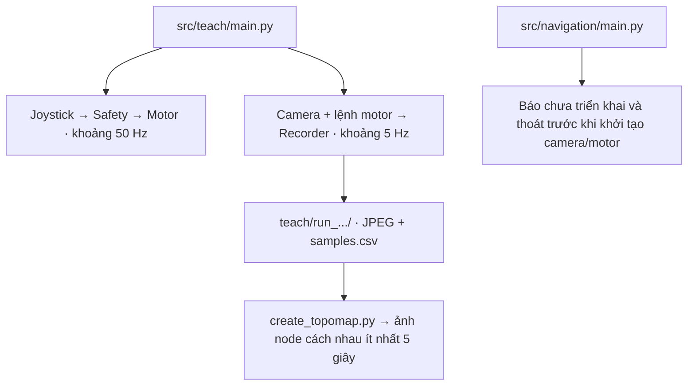

# the-patrol-jetbot

Đồ án xây dựng robot JetBot có thể học một tuyến đường trong nhà rồi tự
lặp lại tuyến đó để tuần tra. Người dùng lái robot một lần bằng joystick;
camera ghi lại các quan sát để tạo bản đồ topo gồm các điểm trên tuyến.
Khi chạy lại, robot so sánh ảnh hiện tại với bản đồ, chọn mục tiêu phía
trước và dự đoán waypoint để điều khiển hai bánh.

## Luồng chạy



## Luồng đích theo PlaceNav

- **Teach:** lái bằng joystick và ghi JPEG + CSV khoảng 5 Hz → kết thúc phiên →
  chạy `create_topomap.py` để xuất ảnh node theo timestamp, mặc định cách nhau
  ít nhất 5 giây. ROSBag chưa triển khai; luồng tạo map hiện không cần ROS/odometry.
- **Navigation:** ảnh camera + TOPOMAP → inference/định vị → chọn subgoal →
  GNM predict waypoints → PD controller đổi sang `(v, omega)` → safety →
  `JetMotors.drive()`. Chưa nối thành luồng tự hành; yêu cầu cập nhật waypoint
  **5 Hz (200 ms/vòng)**.

## Khởi tạo môi trường uv trên JetBot

Hướng dẫn dành cho **Jetson Nano ARM64, JetPack 4.5 / L4T 32.5.0,
Python 3.6.9**, đã cài CUDA/TensorRT và OpenCV có GStreamer từ JetPack.
Thực hiện trong terminal trên JetBot hoặc qua SSH; dùng cùng host/container
cho các bước dưới.

### 1. Kiểm tra máy và cài thư viện hệ thống

```sh
cat /etc/nv_tegra_release
/usr/bin/python3 --version
uname -m
```

Kết quả tương ứng L4T R32.5, Python 3.6.9 và `aarch64`. Cài các gói native
để build JetBot, Pygame và PyGObject:

```sh
sudo apt update
sudo apt install git curl ca-certificates cmake build-essential pkg-config python3-dev \
  libgirepository1.0-dev libcairo2-dev libglib2.0-dev libffi-dev \
  libfreetype6-dev libpng-dev libjpeg-dev zlib1g-dev \
  libopenblas-dev liblapack-dev gfortran \
  libsdl2-dev libsdl2-image-dev libsdl2-mixer-dev libsdl2-ttf-dev libportmidi-dev \
  gir1.2-gstreamer-1.0 gir1.2-gst-plugins-base-1.0 \
  gstreamer1.0-tools gstreamer1.0-plugins-base gstreamer1.0-plugins-good \
  python3-libnvinfer
```

### 2. Cài uv và tải repo

Nếu chưa có uv, dùng [installer chính thức](https://docs.astral.sh/uv/getting-started/installation/):

```sh
curl -LsSf https://astral.sh/uv/install.sh | sh
. "$HOME/.local/bin/env"
uv --version
```

Nếu đã có repo, chỉ cần vào `~/the-patrol-jetbot/robot`, bỏ qua lệnh clone.

```sh
cd ~
git clone https://github.com/ToiLaKiet/the-patrol-jetbot.git
cd ~/the-patrol-jetbot/robot
```

### 3. Tạo .venv và đồng bộ dependency

Repo đã có [pyproject.toml](robot/pyproject.toml) và [uv.lock](robot/uv.lock).
Chạy từ `robot/`; giữ môi trường đang có nếu nó hoạt động tốt:

```sh
export OPENBLAS_CORETYPE=ARMV8
if [ ! -d .venv ]; then
  uv venv --python /usr/bin/python3 --system-site-packages
fi
uv sync --locked --inexact
```

`--system-site-packages` cho Python trong `.venv` thấy OpenCV/TensorRT của
JetPack. Nếu dùng lại môi trường cũ, kiểm tra `.venv/pyvenv.cfg` có
`include-system-site-packages = true`. OpenCV phải là bản có GStreamer;
không cài chồng `opencv-python`/headless từ PyPI để thay bản JetPack.

`--locked` giữ nguyên lockfile; `--inexact` giữ các package cài riêng như
PyTorch/torchvision nếu không xung đột với dependency của dự án; xem
[tài liệu uv sync](https://docs.astral.sh/uv/concepts/projects/sync/).

### 4. PyTorch/torchvision và kiểm tra môi trường

PyTorch/torchvision được cài riêng, chưa nằm trong `uv.lock`. Cặp đã chạy
trên Nano của dự án là **PyTorch 1.10.0 / torchvision 0.11.1**, CUDA build
**10.2**. Nếu đã có cặp này, giữ lại và chạy khối kiểm tra bên dưới.

<details>
<summary>Nếu môi trường chưa có PyTorch/torchvision</summary>

Cài wheel Python 3.6 / ARM64 từ [hướng dẫn NVIDIA cho JetPack 4](https://forums.developer.nvidia.com/t/pytorch-for-jetson/72048/1276),
chạy trong `robot/`:

```sh
curl -fL https://nvidia.box.com/shared/static/fjtbno0vpo676a25cgvuqc1wty0fkkg6.whl \
  -o /tmp/torch-1.10.0-cp36-cp36m-linux_aarch64.whl &&
uv pip install --python .venv/bin/python /tmp/torch-1.10.0-cp36-cp36m-linux_aarch64.whl
```

Với torchvision, build từ [tag v0.11.1](https://github.com/pytorch/vision/tree/v0.11.1)
sau khi Torch đã import được. Giữ dependency hiện tại bằng `--no-deps`:

```sh
uv run --no-sync python -c "import torch; print(torch.__version__); assert torch.cuda.is_available()" &&
uv pip install --python .venv/bin/python 'wheel==0.37.1' &&
MAX_JOBS=1 BUILD_VERSION=0.11.1 uv pip install --python .venv/bin/python --no-deps --no-build-isolation \
  'git+https://github.com/pytorch/vision.git@v0.11.1'
```

</details>

Kiểm tra bằng đúng môi trường robot, chưa mở camera hoặc điều khiển motor:

```sh
uv run --no-sync python - <<'PY'
import re
import sys
import cv2
import torch
import torchvision
import tensorrt
from importlib_metadata import version

print("Python:", sys.version, sys.executable)
print("JetBot:", version("jetbot"))
print("OpenCV:", cv2.__version__, cv2.__file__)
print("TensorRT:", tensorrt.__version__)
print("PyTorch / torchvision:", torch.__version__, torchvision.__version__)
print("PyTorch build CUDA:", torch.version.cuda)
assert re.search(r"^\s*GStreamer:\s+YES\b", cv2.getBuildInformation(), re.MULTILINE)
assert torch.cuda.is_available(), "PyTorch chưa sử dụng được GPU"
import jetbot
print("OK: import JetBot, OpenCV có GStreamer, PyTorch nhận GPU.")
PY
```

Nếu gặp lỗi `libgomp.so.1: cannot allocate memory in static TLS block`, đặt
biến sau trong terminal hiện tại rồi kiểm tra lại:

```sh
export LD_PRELOAD="/usr/lib/aarch64-linux-gnu/libgomp.so.1${LD_PRELOAD:+:$LD_PRELOAD}"
```

## Chạy trên JetBot

Mỗi lần mở terminal mới, vào `robot/`. `uv run --no-sync` dùng `.venv` đã
chuẩn bị, không cần activate hoặc đồng bộ lại trước mỗi lần chạy:

```sh
cd ~/the-patrol-jetbot/robot

# Joystick + ghi JPEG/CSV; mặc định lưu vào teach/
uv run --no-sync python src/teach/main.py

# Sau khi kết thúc Teach: thay run_... bằng thư mục phiên đã in ra
uv run --no-sync python src/teach/create_topomap.py teach/run_... topomaps/route_a

# Khung Navigation: hiện báo chưa triển khai, không điều khiển motor
uv run --no-sync python src/navigation/main.py
```

Teach mặc định mở camera và ghi dữ liệu. Đưa cần về giữa, thả L1 rồi giữ L1
để lái; thả L1 để dừng, `Ctrl+C` để kết thúc và đóng tài nguyên.
Tạo topomap là bước riêng sau khi đóng phiên; thư mục map đích phải chưa tồn tại.
Chi tiết lấy mẫu và giới hạn ở [hướng dẫn Teach](robot/src/teach/README.md).

## Mã nguồn và tiến độ

- [Teach](robot/src/teach/main.py): joystick và thu dữ liệu hiện tại.
- [Navigation](robot/src/navigation/main.py): điểm vào của luồng tự hành chưa triển khai.
- [Checklist](checklist.md): kết quả đã có và các bước triển khai tiếp theo.
