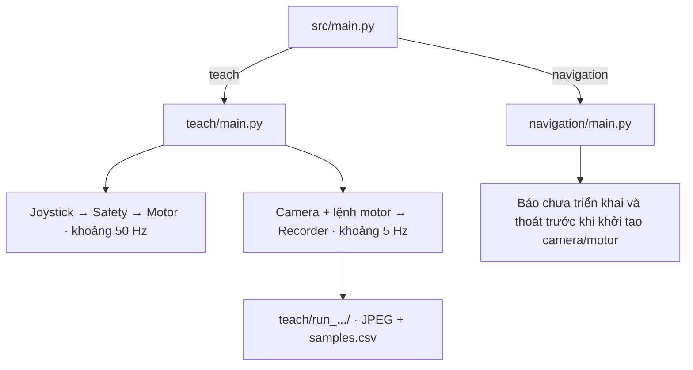

# the-patrol-jetbot

JetBot tuần tra trong nhà theo hướng Teach & Repeat. Entry point gồm hai
giai đoạn: **Teach** (joystick + ghi JPEG/CSV hiện có, ROSBag/TOPOMAP đang
để trống) và **Navigation** (khung luồng tự hành, chưa triển khai).

## Luồng chạy hiện tại



## Luồng đích theo PlaceNav

- **Teach:** lái bằng joystick, đồng thời Collect ROSBag → kết thúc phiên →
  create TOPOMAP. ROSBag và tạo TOPOMAP hiện là file trống; dữ liệu đang thu
  là JPEG + CSV.
- **Navigation:** ảnh camera + TOPOMAP → inference/định vị → chọn subgoal →
  GNM predict waypoints → PD controller đổi sang `(v, omega)` → safety →
  `JetMotors.drive()`. Chưa nối thành luồng tự hành; yêu cầu cập nhật waypoint
  **5 Hz (200 ms/vòng)**.

## Chạy trên JetBot

Trên JetBot đã cài môi trường Python của robot, chạy từ gốc repo:

```sh
cd robot

# Joystick + ghi JPEG/CSV; mặc định lưu vào teach/
uv run --no-sync python src/main.py teach

# Khung Navigation: hiện báo chưa triển khai, không điều khiển motor
uv run --no-sync python src/main.py navigation
```

Teach mặc định mở camera và ghi dữ liệu. Đưa cần về giữa, thả L1 rồi giữ L1
để lái; thả L1 để dừng, `Ctrl+C` để kết thúc và đóng tài nguyên.

## Mã nguồn và tiến độ

- [Entry point](robot/src/main.py): chọn giai đoạn và kiểm tra tham số CLI.
- [Teach](robot/src/teach/main.py): joystick và thu dữ liệu hiện tại.
- [Navigation](robot/src/navigation/main.py): điểm vào của luồng tự hành chưa triển khai.
- [Checklist](checklist.md): kết quả đã có và các bước triển khai tiếp theo.
