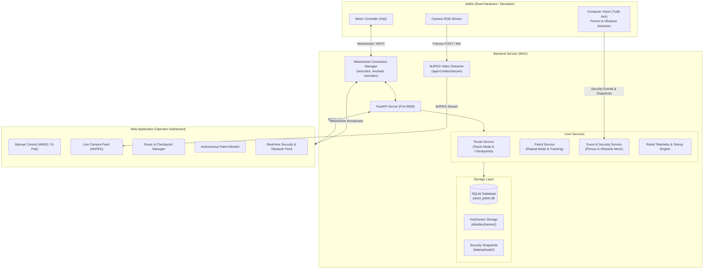

# The Patrol Jetbot - Backend Service

> **Dự án:** Hệ thống robot tuần tra an ninh trong nhà sử dụng Computer Vision và Teach & Repeat Navigation.  
> **Thành viên phụ trách:** Minh — Backend Engineer.  
> **Nhiệm vụ chính:** Robot-server communication, REST API, Route & Event Storage, Video streaming relay, JetBot Simulator.

---

## 1. Giới thiệu tổng quan (Project Overview)

Backend Service là trái tim điều phối toàn bộ hệ thống **The Patrol Jetbot v1.0**, kết nối giữa:
1. **Robot NVIDIA JetBot** (Điều khiển động cơ bởi Kiệt, Computer Vision bởi Tuấn Anh).
2. **Web Application Monitoring Dashboard** (Giao diện giám sát & điều khiển của người vận hành).

Được thiết kế theo định hướng kiến trúc mở (**Phase 1 Feasibility & Independent Testing**): **Backend và Frontend có thể phát triển song song hoàn toàn độc lập với phần cứng thực tế thông qua JetBot Simulator.**

---

## 2. Kiến trúc hệ thống (System Architecture)



---

## 3. Các thành phần được thiết kế độc lập (Independent Modules)

Theo bản kế hoạch dự án, Backend Service đã hoàn thiện đầy đủ các phân hệ có thể vận hành độc lập:

### 3.1. RESTful API & OpenAPI Documentation
- **Tự động sinh tài liệu Swagger UI:** Truy cập trực tiếp tại `http://localhost:8000/docs` hoặc ReDoc tại `http://localhost:8000/redoc`.
- Chuẩn hóa toàn bộ request/response bằng **Pydantic v2 schemas**.

### 3.2. Real-time Communication (WebSocket Hub)
- `/ws/robot`: Kênh kết nối dành riêng cho JetBot (hoặc Simulator) để truyền nhận telemetry, sự kiện nhận diện người/vật cản và nhận lệnh điều khiển động cơ.
- `/ws/web`: Kênh phát thông tin thời gian thực đến tất cả Web Dashboard (trạng thái robot, tiến độ tuần tra, cảnh báo an ninh).
- `/ws/video`: Kênh stream binary frames tốc độ cao từ camera robot.

### 3.3. Database & Storage Layer (SQLAlchemy 2.0 + SQLite)
- **Routes (`routes`):** Lưu trữ hành trình tuần tra (tên, mô tả, độ dài ước tính, thời gian, số lượng checkpoint).
- **Checkpoints (`checkpoints`):** Từng mốc tọa độ tương đối $(x, y, \theta)$, vận tốc đã ghi, và ảnh keyframe tham chiếu của camera.
- **Patrol Sessions (`patrol_sessions`):** Quản lý phiên tuần tra lặp lại (trạng thái `RUNNING`, `PAUSED`, `BLOCKED`, `COMPLETED`, tiến độ %).
- **Security Events (`security_events`):** Lưu các sự kiện phát hiện người (`PERSON_DETECTED`), dừng trước vật cản (`OBSTACLE_BLOCKED`), giải tỏa vật cản (`OBSTACLE_CLEARED`), dừng khẩn cấp (`EMERGENCY_STOP`) kèm độ tin cậy và ảnh chụp snapshot.
- **Robot State & Logs (`robot_states`, `robot_logs`):** Quản lý trạng thái nguồn pin, Wi-Fi, vị trí hiện tại và lịch sử log vận hành.

### 3.4. JetBot Hardware Simulator (`backend/simulator/jetbot_simulator.py`)
- Giả lập hoàn hảo phần cứng NVIDIA JetBot:
  - Sinh video stream camera RGB giả lập với HUD tọa độ, thời gian thực và hình ảnh perspective hành lang.
  - Phản hồi lệnh điều khiển lái thủ công (Teleoperation).
  - Giả lập chế độ **Teach Mode**: Ghi lại các checkpoint mốc tọa độ và sinh ảnh keyframe mẫu.
  - Giả lập chế độ **Repeat Mode**: Tự động di chuyển bám theo danh sách checkpoint của tuyến và cập nhật tiến độ tuần tra.
  - Giả lập **Phát hiện vật cản**: Robot dừng xe -> chuyển trạng thái `BLOCKED` -> gửi sự kiện cảnh báo -> sau khi vật cản rời đi thì tự tiếp tục (`Stop & Resume`).
  - Giả lập **Phát hiện người**: Bắt khung hình có bounding box người -> gửi cảnh báo bảo mật về Backend và Web App.

### 3.5. Built-in Web Monitoring Dashboard (`backend/static/`)
- Giao diện Dark Mode hiện đại, trực quan, hỗ trợ kiểm thử và demo tức thì ngay từ Phase 1:
  - **Live Camera Stream** (MJPEG).
  - **Bàn điều khiển ảo & phím tắt (W, A, S, D, Space, E-Stop)**.
  - **Quản lý hành trình (Ghi tuyến, xem danh sách, xóa, bắt đầu tuần tra)**.
  - **Tiến độ tuần tra tự động (Progress bar, Checkpoint counter, Pause/Resume/Abort)**.
  - **Bảng sự kiện an ninh thời gian thực** kèm chức năng xem ảnh snapshot popup.
  - **Nút bấm kích hoạt nhanh kịch bản giả lập (Trigger Obstacle, Trigger Person)**.

---

## 4. Danh mục API Endpoints

| Phân hệ | Phương thức | Endpoint | Mô tả |
|---|---|---|---|
| **Teleoperation** | `POST` | `/api/v1/teleop/command` | Gửi lệnh di chuyển: `FORWARD`, `BACKWARD`, `LEFT`, `RIGHT`, `STOP` |
| | `POST` | `/api/v1/teleop/emergency-stop` | Kích hoạt dừng khẩn cấp toàn hệ thống |
| **Routes** | `GET` | `/api/v1/routes` | Lấy danh sách tất cả các hành trình đã lưu |
| | `POST` | `/api/v1/routes` | Tạo hành trình mới |
| | `POST` | `/api/v1/routes/start-recording` | Bắt đầu ghi hành trình trong Teach Mode |
| | `POST` | `/api/v1/routes/{id}/stop-recording` | Kết thúc và lưu hành trình |
| | `GET` | `/api/v1/routes/{id}` | Lấy chi tiết tuyến đường kèm toàn bộ checkpoints |
| | `POST` | `/api/v1/routes/{id}/checkpoints` | Thêm checkpoint mới (tọa độ, tốc độ, keyframe) |
| | `GET` | `/api/v1/routes/{id}/keyframes/{file}` | Tải/xem ảnh keyframe tham chiếu |
| | `DELETE` | `/api/v1/routes/{id}` | Xóa tuyến đường và dữ liệu ảnh liên quan |
| **Patrol** | `POST` | `/api/v1/patrol/start` | Bắt đầu phiên tuần tra tự động theo tuyến chọn |
| | `GET` | `/api/v1/patrol/active` | Lấy trạng thái phiên tuần tra đang chạy |
| | `GET` | `/api/v1/patrol/sessions` | Lịch sử các phiên tuần tra đã thực hiện |
| | `POST` | `/api/v1/patrol/{id}/progress` | Cập nhật tiến độ checkpoint & % hoàn thành |
| | `POST` | `/api/v1/patrol/{id}/pause` | Tạm dừng tuần tra |
| | `POST` | `/api/v1/patrol/{id}/resume` | Tiếp tục tuần tra |
| | `POST` | `/api/v1/patrol/{id}/stop` | Hủy / kết thúc phiên tuần tra |
| **Events** | `GET` | `/api/v1/events` | Danh sách sự kiện bảo mật & vật cản (lọc theo loại/mức độ) |
| | `POST` | `/api/v1/events` | Ghi nhận sự kiện bảo mật mới (kèm ảnh base64) |
| | `POST` | `/api/v1/events/upload-snapshot` | Ghi nhận sự kiện bằng file upload |
| | `GET` | `/api/v1/events/{id}/snapshot` | Xem ảnh chụp minh chứng sự kiện |
| | `POST` | `/api/v1/events/{id}/resolve` | Đánh dấu sự kiện đã được kiểm tra / xử lý |
| | `GET` | `/api/v1/events/system/logs` | Xem danh sách nhật ký hệ thống |
| **Robot Status** | `GET` | `/api/v1/robot/status` | Lấy trạng thái robot (pin, Wi-Fi, chế độ, tọa độ) |
| | `POST` | `/api/v1/robot/telemetry` | Cập nhật telemetry từ robot |
| | `POST` | `/api/v1/robot/heartbeat` | Gửi tín hiệu nhịp tim duy trì kết nối |
| **Video** | `GET` | `/api/v1/video/stream` | Stream camera MJPEG trực tiếp |
| | `GET` | `/api/v1/video/frame` | Lấy khung hình đơn mới nhất |
| | `POST` | `/api/v1/video/frame` | Đẩy khung hình JPEG từ camera robot lên server |

---

## 5. Hướng dẫn cài đặt và khởi chạy (Quick Start)

### 5.1. Yêu cầu môi trường
- Python 3.10+ (Đã kiểm thử tương thích hoàn toàn trên Python 3.12).
- Các thư viện cốt lõi: `fastapi`, `uvicorn`, `sqlalchemy`, `pydantic`, `pillow`, `websockets`, `python-multipart`, `pytest`.

### 5.2. Cài đặt thư viện
```bash
cd backend
pip install -r requirements.txt
```

### 5.3. Khởi tạo dữ liệu mẫu (Seed Data)
Để có sẵn dữ liệu hành trình mẫu ("Tuyến Tuần Tra Tầng 1 - Khu Văn Phòng" gồm 6 checkpoints, ảnh keyframe và sự kiện an ninh):
```bash
python scripts/seed_data.py
```

### 5.4. Chạy Backend Server
```bash
python scripts/run_server.py
```
- **Web Monitoring Dashboard:** Mở trình duyệt truy cập `http://localhost:8000/`
- **Swagger Interactive API Docs:** `http://localhost:8000/docs`

### 5.5. Chạy JetBot Simulator (Phát triển độc lập)
Trong một cửa sổ terminal riêng, chạy simulator:
```bash
python simulator/jetbot_simulator.py
```
Ngay lập tức:
- Simulator sẽ kết nối WebSocket đến Backend (`/ws/robot`).
- Bắt đầu stream camera giả lập lên Dashboard.
- Nhận lệnh lái từ Web Dashboard và cập nhật tọa độ ảo.
- Có thể chạy thử toàn bộ quy trình: Ghi tuyến (Teach) -> Tuần tra tự động (Repeat) -> Gặp vật cản dừng và đi tiếp -> Báo động phát hiện người.

### 5.6. Chạy bộ kiểm thử tự động (Unit & Integration Tests)
Toàn bộ hệ thống đi kèm 12 bài test tự động bao phủ 100% các tính năng quan trọng:
```bash
pytest tests -v
```
Kết quả kiểm thử đạt **12/12 passed (100%)**.

---

## 6. Phân công và phối hợp tiếp theo với các thành viên

| Thành viên | Giao diện tích hợp với Backend |
|---|---|
| **Kiệt (Robotics)** | Kết nối vào `/ws/robot` để nhận lệnh teleop (`FORWARD`, `BACKWARD`, `LEFT`, `RIGHT`, `STOP`) và nhận lệnh `START_PATROL` kèm danh sách checkpoints để bộ điều khiển motor chạy lại hành trình. |
| **Tuấn Anh (CV)** | Gửi sự kiện phát hiện người (`POST /api/v1/events` hoặc WebSocket) kèm bounding box và ảnh chụp snapshot camera RGB. Gửi sự kiện `OBSTACLE_BLOCKED` khi có vật cản và `OBSTACLE_CLEARED` khi đường thông thoáng. |
| **Frontend** | Kết nối trực tiếp vào `/ws/web` để nhận telemetry và alert realtime, gọi REST API theo chuẩn tại `/docs`, nhúng live stream qua thẻ ``. |
