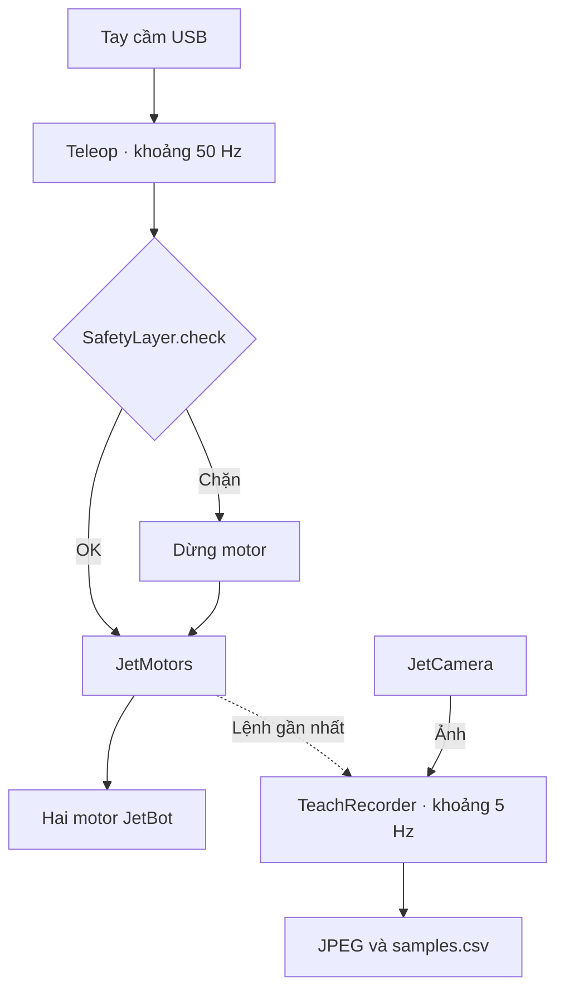

# Robot

Điều khiển JetBot bằng tay cầm USB và ghi hành trình teach trên **Jetson Nano,
JetPack 4.5 / L4T R32.5, Python 3.6.9**. Hiện chạy teleop và ghi dữ liệu;
chưa có luồng tự hành Teach & Repeat hoàn chỉnh.

## Khởi tạo trên JetBot


Các bước dưới dành cho **Jetson Nano, JetPack 4.5 / L4T R32.5,
Python 3.6.9, ARM64**, đã có hệ điều hành và CUDA/TensorRT đúng JetPack.
Chạy trong terminal trên JetBot hoặc qua SSH (`ssh jetbot@<IP_JETBOT>`,
thay `<IP_JETBOT>` bằng địa chỉ máy). Dùng cùng một host/container cho mọi bước.

### 1. Kiểm tra máy và tải repo

```sh
cat /etc/nv_tegra_release
/usr/bin/python3 --version
uname -m

sudo apt update
sudo apt install git curl ca-certificates
cd ~
git clone https://github.com/ToiLaKiet/the-patrol-jetbot.git
cd the-patrol-jetbot/robot
```

Kết quả cần là L4T R32.5, Python 3.6.9 và `aarch64`.
Nếu đã clone repo, chỉ cần vào `~/the-patrol-jetbot/robot`, bỏ qua lệnh clone.
Các bước tiếp theo đều chạy từ thư mục `robot/` này.

### 2. Cài công cụ và thư viện hệ thống

Nếu chưa có `uv`, cài bằng [installer chính thức](https://docs.astral.sh/uv/getting-started/installation/):

```sh
curl -LsSf https://astral.sh/uv/install.sh | sh
. "$HOME/.local/bin/env"
uv --version
```

Cài các gói native để build JetBot, Pygame và dùng thư viện JetPack:

```sh
sudo apt install cmake build-essential pkg-config python3-dev \
  libgirepository1.0-dev libcairo2-dev libglib2.0-dev libffi-dev \
  libfreetype6-dev libpng-dev libjpeg-dev zlib1g-dev \
  libopenblas-dev liblapack-dev gfortran \
  libsdl2-dev libsdl2-image-dev libsdl2-mixer-dev libsdl2-ttf-dev libportmidi-dev \
  gir1.2-gstreamer-1.0 gir1.2-gst-plugins-base-1.0 \
  gstreamer1.0-tools gstreamer1.0-plugins-base gstreamer1.0-plugins-good \
  python3-libnvinfer
```

### 3. Tạo môi trường Python

Repo đã có `pyproject.toml` và `uv.lock`, không cần chạy `uv init`.
Nếu đã có `.venv` chạy tốt thì giữ lại và bỏ qua lệnh tạo môi trường.
Nếu cần thay môi trường cũ, chuyển nó ra ngoài repo trước để có thể phục hồi;
chỉ chạy lệnh này khi đang ở `robot/` và thực sự muốn thay `.venv` hiện có:

```sh
mv .venv "$HOME/patrol-jetbot-venv-backup-$(date +%Y%m%d-%H%M%S)"
```

```sh
export OPENBLAS_CORETYPE=ARMV8
uv venv --python /usr/bin/python3 --system-site-packages
uv sync --locked --inexact
```

`--system-site-packages` cho phép dùng TensorRT của JetPack;
`--inexact` giữ lại PyTorch được cài riêng. Không đổi Python hệ thống.

### 4. Kiểm tra và cài PyTorch NVIDIA nếu thiếu

```sh
uv run --no-sync python -c "import torch; print(torch.__version__); print(torch.version.cuda)"
```

Mục tiêu là Torch 1.10.0 / CUDA 10.2. Nếu chưa có Torch, cài wheel ARM64
của NVIDIA, không dùng bộ requirements gốc của PlaceNav:

```sh
curl -fL https://nvidia.box.com/shared/static/fjtbno0vpo676a25cgvuqc1wty0fkkg6.whl -o /tmp/torch-1.10.0-cp36-cp36m-linux_aarch64.whl
uv pip install /tmp/torch-1.10.0-cp36-cp36m-linux_aarch64.whl
```

Nếu gặp lỗi `libgomp.so.1: cannot allocate memory in static TLS block`,
đặt biến này trước khi chạy lại Python trong cùng terminal:

```sh
export LD_PRELOAD="/usr/lib/aarch64-linux-gnu/libgomp.so.1${LD_PRELOAD:+:$LD_PRELOAD}"
```

Các gói CUDA/TensorRT và plugin GStreamer `nvjpegenc` phải đến từ JetPack
đang cài. Không dùng repository NVIDIA cho JetPack mới hơn. JetBot v0.4.3
được cài từ Git tag gốc và build plugin TensorRT bằng CMake/Make; build thành
công chưa bảo đảm các thư viện native import được, nên vẫn cần chạy checker.

Phiên bản dependency được giữ trong [pyproject.toml](pyproject.toml) và
`uv.lock`. Upstream JetBot import cả camera, heartbeat và ObjectDetector,
nên PyTorch/TensorRT vẫn cần cho cả chế độ chỉ điều khiển motor.

## Chạy

Sau khi cài môi trường ở trên, chạy từ `robot/`. Những lần sau chỉ cần
vào thư mục này; `uv run --no-sync` tự dùng `.venv`, không cần kích hoạt thủ công.
Đặt lại biến môi trường ở trên nếu chưa lưu trong cấu hình shell.

Kiểm tra dependency trước:

```sh
uv run --no-sync python check_jetbot_env.py
uv run --no-sync python -c "import torch; print('CUDA:', torch.cuda.is_available())"
```

Checker không tạo `Robot` hoặc gửi lệnh motor; nó kiểm tra từng dependency
trong subprocess rồi mới thử import toàn bộ JetBot. Khi checker đạt và đã
cắm tay cầm, chạy main:

```sh
uv run --no-sync python src/main.py
```

Đưa cần trái về giữa, thả L1 rồi giữ L1 để lái. Thả L1 để dừng;
Ctrl+C để kết thúc. Mapping hiện tại: axes 0/1, L1 button 4.
Kê bánh để kiểm tra chiều quay và thao tác dừng trước khi chạy dưới đất.

```sh
# Ghi ảnh, timestamp và lệnh hai motor ở khoảng 5 Hz
uv run --no-sync python src/main.py --teach-dir teach

# Chỉnh độ nhạy và tốc độ thay đổi lệnh
uv run --no-sync python src/main.py --max-speed 0.1 --deadzone 0.08 --slew-rate 0.3
```

Mặc định CLI: `max-speed=0.1`, `deadzone=0.08`, `slew-rate=0.5`.
`max-speed` là lệnh motor chuẩn hóa, không phải m/s. Teach lưu từng phiên
vào `teach/run_.../`; xem [định dạng dữ liệu](src/teach/README.md).

## Luồng đang chạy



Nhánh ghi chỉ bật khi có `--teach-dir`. Teleop kiểm tra lỗi recorder trước
khi gửi lệnh; lỗi camera hoặc ghi đĩa kết thúc phiên và dừng motor.
`PatrolJet` quản lý vòng đời; khi đóng, dừng motor rồi đóng recorder và camera.

## Đọc code

| Thư mục | Nội dung |
| --- | --- |
| [src](src/README.md) | Entry point và cách nối các thành phần |
| [hardware](src/hardware/README.md) | Camera, motor và vòng đời robot |
| [teleop](src/teleop/README.md) | Joystick, trộn lệnh và làm mượt |
| [safety](src/safety/README.md) | Điều kiện chặn và giới hạn vận tốc |
| [teach](src/teach/README.md) | Recorder và định dạng dữ liệu |
| [humandetector](src/humandetector/README.md) | Code nhận diện người chưa tích hợp |
| [mapping](src/mapping/README.md), [navigation](src/navigation/README.md) | File giữ chỗ, chưa triển khai |
| [tests](tests/README.md) | Kiểm tra tự động bằng phần cứng giả |

## Kiểm tra

```sh
PYTHONPATH=src uv run --no-sync python -m unittest discover -s tests -v
```

## Giới hạn

Camera CSI cần OpenCV có backend GStreamer phù hợp; bản headless hiện tại
không cung cấp backend đó. Test trên máy phát triển không thay thế kiểm tra
camera/motor trên Nano. Không cài nhiều package OpenCV vào cùng môi trường.

Python 3.6 được giữ để tương thích JetPack cũ. Môi trường này chưa chạy nguyên
bộ requirements PlaceNav (Python mới hơn, Torch 1.11 / CUDA 11.3).
Không có runtime hiện tại cần Matplotlib hoặc bộ chuyển đổi TensorFlow/UFF.

Tham khảo lỗi môi trường: [OpenBLAS trên Nano](https://github.com/numpy/numpy/issues/18131),
[OpenMP static TLS](https://docs.nvidia.com/metropolis/deepstream/7.1/text/DS_FAQ.html#how-to-fix-cannot-allocate-memory-in-static-tls-block-error),
[PyTorch NVIDIA cho Jetson](https://forums.developer.nvidia.com/t/pytorch-for-jetson/72048/1276).
