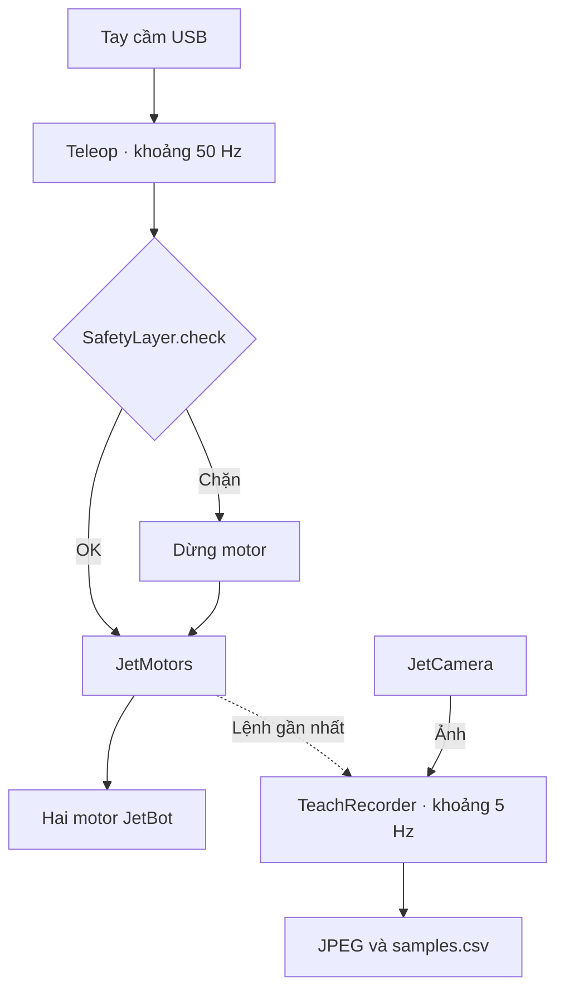

# Robot

Điều khiển JetBot bằng tay cầm USB và ghi hành trình teach trên **Jetson Nano,
JetPack 4.5 / L4T R32.5, Python 3.6.9**. Hiện chạy teleop và ghi dữ liệu;
chưa có luồng tự hành Teach & Repeat hoàn chỉnh.

## Chạy

[Cài đặt và xử lý lỗi Jetson](docs/README.md) trước, rồi chạy từ `robot/`:

```sh
uv run --no-sync python check_jetbot_env.py
uv run --no-sync python src/main.py
```

Đưa cần trái về giữa, thả L1 rồi giữ L1 để lái. Thả L1 để dừng;
Ctrl+C để kết thúc. Mapping hiện tại: axes 0/1, L1 button 4.
Kê bánh để kiểm tra chiều quay và thao tác dừng trước khi chạy dưới đất.

```sh
# Ghi ảnh, timestamp và lệnh hai motor ở khoảng 5 Hz
uv run --no-sync python src/main.py --teach-dir teach

# Chỉnh độ nhạy và tốc độ thay đổi lệnh
uv run --no-sync python src/main.py --max-speed 0.1 --deadzone 0.08 --slew-rate 0.3
```

Mặc định CLI: `max-speed=0.1`, `deadzone=0.08`, `slew-rate=0.5`.
`max-speed` là lệnh motor chuẩn hóa, không phải m/s. Teach lưu từng phiên
vào `teach/run_.../`; xem [định dạng dữ liệu](src/teach/README.md).

## Luồng đang chạy



Nhánh ghi chỉ bật khi có `--teach-dir`. Teleop kiểm tra lỗi recorder trước
khi gửi lệnh; lỗi camera hoặc ghi đĩa kết thúc phiên và dừng motor.
`PatrolJet` quản lý vòng đời; khi đóng, dừng motor rồi đóng recorder và camera.

## Đọc code

| Thư mục | Nội dung |
| --- | --- |
| [src](src/README.md) | Entry point và cách nối các thành phần |
| [hardware](src/hardware/README.md) | Camera, motor và vòng đời robot |
| [teleop](src/teleop/README.md) | Joystick, trộn lệnh và làm mượt |
| [safety](src/safety/README.md) | Điều kiện chặn và giới hạn vận tốc |
| [teach](src/teach/README.md) | Recorder và định dạng dữ liệu |
| [humandetector](src/humandetector/README.md) | Code nhận diện người chưa tích hợp |
| [mapping](src/mapping/README.md), [navigation](src/navigation/README.md) | File giữ chỗ, chưa triển khai |
| [tests](tests/README.md) | Kiểm tra tự động bằng phần cứng giả |

## Kiểm tra

```sh
PYTHONPATH=src uv run --no-sync python -m unittest discover -s tests -v
```

Camera CSI cần OpenCV có backend GStreamer phù hợp; bản headless hiện tại
không cung cấp backend đó. Test trên máy phát triển không thay thế kiểm tra
camera/motor trên Nano. Xem [giới hạn môi trường](docs/README.md#limits).
