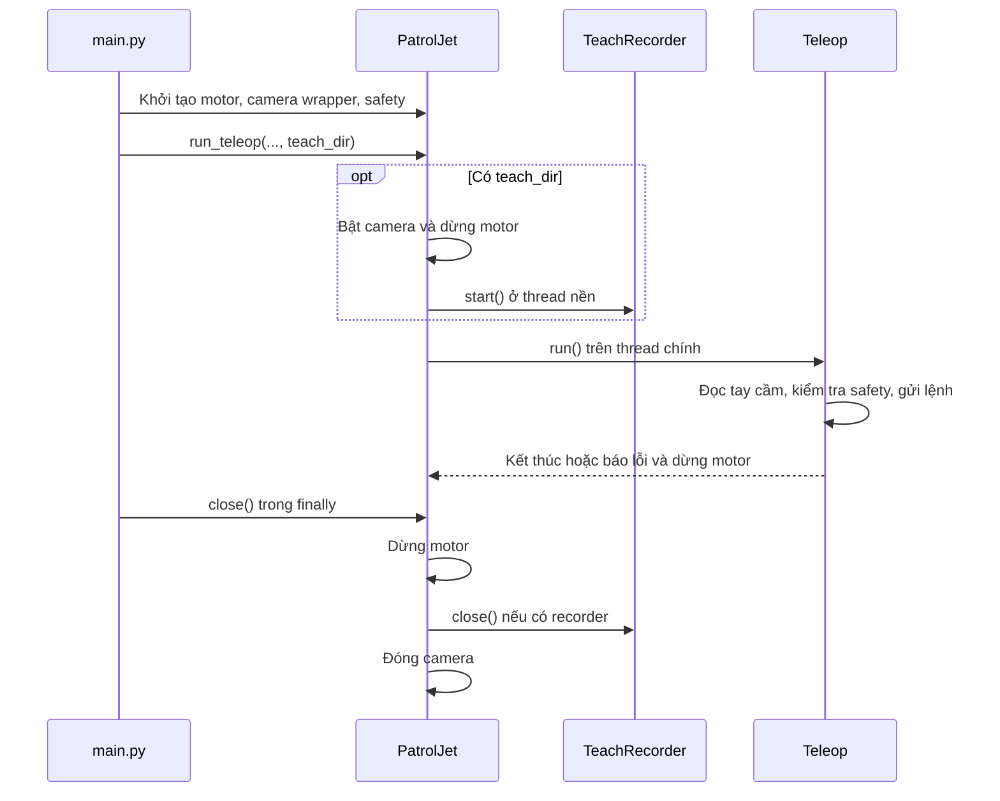

# Luồng ứng dụng

[main.py](main.py) đọc và kiểm tra CLI trước khi import phần cứng.
Trên ARM64, entry point đặt mặc định `OPENBLAS_CORETYPE=ARMV8` trước các
thư viện native. Sau đó tạo một `PatrolJet`, gọi `run_teleop()` và luôn
`close()` trong `finally`.



| Module | Vai trò trong luồng hiện tại |
| --- | --- |
| [utils.py](utils.py) | Hàm dùng chung: preprocessing ảnh BGR cho PlaceNav |
| [hardware](hardware/README.md) | `PatrolJet` sở hữu thiết bị và nối các module |
| [teleop](teleop/README.md) | Tạo lệnh hai bánh từ joystick |
| [safety](safety/README.md) | Cho phép chạy hoặc yêu cầu dừng |
| [teach](teach/README.md) | Lấy mẫu ảnh và lệnh motor ở nền |
| [humandetector](humandetector/README.md) | Chưa được entry point gọi |
| [mapping](mapping/README.md) | Chưa có triển khai |
| [navigation](navigation/README.md) | Chưa có vòng lặp tự hành |

`utils.preprocess_frame(frame)` nhận BGR `uint8 [H, W, 3]`, đổi sang RGB →
tensor → resize rộng 85 × cao 64 với antialias → normalize ImageNet.
Output là RGB `float32 [3, 64, 85]` trên CPU; ảnh đầu vào không bị sửa.
`scripts/infer_sample.py` dùng cùng hàm này cho ảnh đọc bằng OpenCV.

```python
from utils import preprocess_frame

image = preprocess_frame(camera.get_frame())
```

Lệnh chạy và tham số nằm trong [hướng dẫn robot](../README.md).
