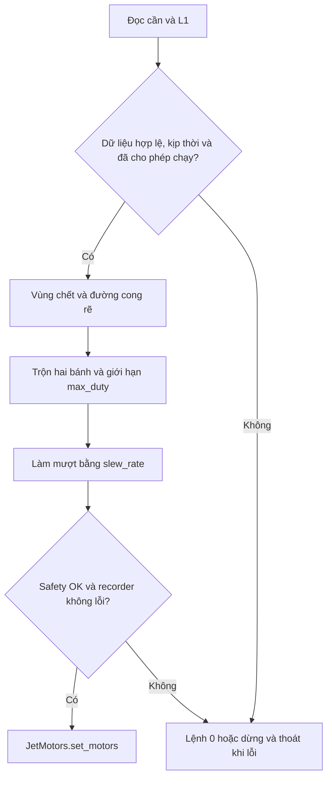

# Teleop

[teleop.py](teleop.py) đọc tay cầm USB bằng Pygame trên thread chính,
tạo lệnh hai bánh ở khoảng 50 Hz. Dùng motor và safety do `PatrolJet`
truyền vào; recorder là tùy chọn ở API. CLI `src/teach/record_route.py` bật recorder
mặc định; lệnh chạy nằm ở [README gốc](../../../README.md).

## Xử lý lệnh



Với trục `a`, trong vùng chết cho ra 0; ngoài vùng chết tính
`sign(a) * (abs(a) - deadzone) / (1 - deadzone)`.
Sau đó `forward = -y`, `turn = x * abs(x)` trên các trục đã xử lý:

```text
left  = forward + turn
right = forward - turn
scale = max(1, abs(left), abs(right))
left, right = max_duty * left / scale, max_duty * right / scale
```

Đường cong rẽ giảm độ nhạy quanh tâm; hết cần vẫn quay hết thang.
Mỗi bánh đổi tối đa `slew_rate * dt`, với `dt` đo bằng `time.monotonic()`.
Ví dụ `slew_rate=0.5`, chu kỳ 0.02 s thì mỗi bước đổi tối đa 0.01.
`max_duty` là lệnh chuẩn hóa, bị chặn tiếp bởi `motors.max_duty`, không phải m/s.

| Tham số | Mặc định CLI | Điều kiện |
| --- | --- | --- |
| `--max-duty` | 0.1 | Hữu hạn, trong (0, 1] |
| `--deadzone` | 0.08 | Hữu hạn, trong [0, 1) |
| `--slew-rate` | 0.5 | Hữu hạn, > 0 |
| `--l1-button` | 4 | Chỉ số nguyên >= 0, nhỏ hơn số nút tay cầm |

CLI, `PatrolJet.run_teleop()` và `Teleop()` cùng mặc định `max_duty=0.1`.
`--max-speed` được giữ làm alias của `--max-duty` để lệnh cũ vẫn chạy.

Nếu phép đo Pygame cho thấy L1 là button 6 (chế độ TGZ đã kiểm tra), chạy Teach
với `--l1-button 6`. Các API `PatrolJet.run_teleop()` và `Teleop()` nhận
`l1_button=6`. Tham số này áp dụng cho cả đọc trạng thái nút và xử lý sự kiện
thả nút; vẫn phải thả L1 và đưa cần về giữa trước khi cho phép chạy.
Trục điều khiển vẫn là axis 0/1. Đo lại mapping nếu đổi chế độ tay cầm.

## Dừng

Thả L1 bỏ qua làm mượt và cho lệnh 0 ngay. Timeout, safety chặn hoặc lỗi
xóa trạng thái làm mượt; phải thả L1 và đưa cần về giữa để cho phép chạy lại.
Thả cần khi vẫn giữ L1 giảm lệnh theo slew rate.

`SafetyLayer.check()` kiểm tra điều kiện chung; teleop không truyền duty vào
API `filter(v, w)` dùng đơn vị vận tốc. Teleop thủ công đặt
`need_localization=False`, `battery=None`; chưa đo pin hoặc yêu cầu camera
qua `SafetyInput`. Khi có recorder, lỗi camera/ghi đĩa đi qua `recorder.check()`.

Ctrl+C, SDL yêu cầu thoát, mất tay cầm hoặc exception đều dừng motor và dọn
Pygame trong `finally`. Đây là dừng bằng phần mềm, không bảo đảm khi tiến trình
hoặc hệ điều hành treo; muốn bảo đảm cần watchdog phần cứng/driver.
