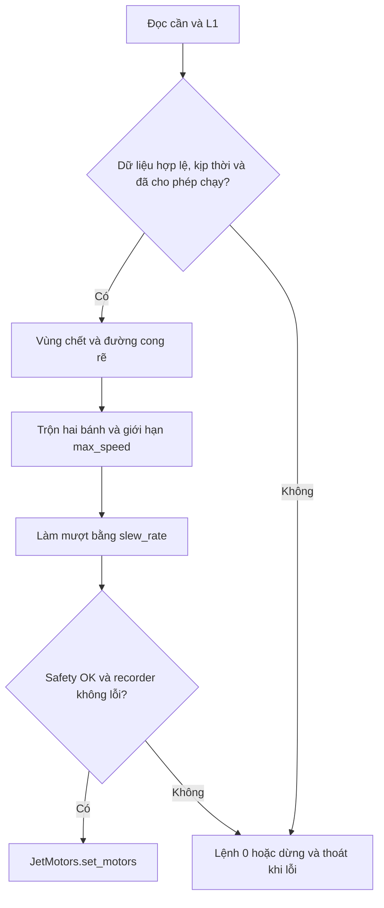

# Teleop

[teleop.py](teleop.py) đọc tay cầm USB bằng Pygame trên thread chính,
tạo lệnh hai bánh ở khoảng 50 Hz. Dùng motor và safety do `PatrolJet`
truyền vào; recorder là tùy chọn. Lệnh chạy nằm ở [README robot](../../README.md).

## Mapping và cho phép chạy

Mapping đã xác nhận khi tay cầm báo `Microsoft X-Box 360 pad`:

| Đầu vào | Ý nghĩa |
| --- | --- |
| Axis 1 âm | Tiến |
| Axis 0 dương | Rẽ phải |
| Button 4 / L1 | Giữ để chạy, thả để dừng |

Ban đầu phải đưa cần về giữa và thả L1, rồi mới giữ L1 để chạy.
Nếu đổi chế độ tay cầm, cần kiểm tra lại mapping. Pygame dùng chế độ joystick
classic, cho phép đọc ở nền và dùng display dummy mặc định để chạy qua SSH.
Code kiểm tra số axes/buttons và instance ID; mất tay cầm kết thúc phiên.

## Xử lý lệnh



Với trục `a`, trong vùng chết cho ra 0; ngoài vùng chết tính
`sign(a) * (abs(a) - deadzone) / (1 - deadzone)`.
Sau đó `forward = -y`, `turn = x * abs(x)` trên các trục đã xử lý:

```text
left  = forward + turn
right = forward - turn
scale = max(1, abs(left), abs(right))
left, right = max_speed * left / scale, max_speed * right / scale
```

Đường cong rẽ giảm độ nhạy quanh tâm; hết cần vẫn quay hết thang.
Mỗi bánh đổi tối đa `slew_rate * dt`, với `dt` đo bằng `time.monotonic()`.
Ví dụ `slew_rate=0.5`, chu kỳ 0.02 s thì mỗi bước đổi tối đa 0.01.
`max_speed` là lệnh chuẩn hóa, bị chặn tiếp bởi `motors.max_duty`, không phải m/s.

| Tham số | Mặc định CLI | Điều kiện |
| --- | --- | --- |
| `--max-speed` | 0.1 | Hữu hạn, trong (0, 1] |
| `--deadzone` | 0.08 | Hữu hạn, trong [0, 1) |
| `--slew-rate` | 0.5 | Hữu hạn, > 0 |

Mặc định constructor `Teleop` là `max_speed=0.25`; entry point truyền giá trị CLI.

## Dừng

Thả L1 bỏ qua làm mượt và cho lệnh 0 ngay. Timeout, safety chặn hoặc lỗi
xóa trạng thái làm mượt; phải thả L1 và đưa cần về giữa để cho phép chạy lại.
Thả cần khi vẫn giữ L1 giảm lệnh theo slew rate.

`SafetyLayer.check()` kiểm tra điều kiện chung; teleop không truyền duty vào
API `filter(v, w)` dùng đơn vị vận tốc. Teleop thủ công đặt
`need_localization=False`, `battery=None`; chưa đo pin hoặc yêu cầu camera
qua `SafetyInput`. Khi có recorder, lỗi camera/ghi đĩa đi qua `recorder.check()`.

Ctrl+C, SDL yêu cầu thoát, mất tay cầm hoặc exception đều dừng motor và dọn
Pygame trong `finally`. Đây là dừng bằng phần mềm, không bảo đảm khi tiến trình
hoặc hệ điều hành treo; muốn bảo đảm cần watchdog phần cứng/driver.

[Test teleop và motor](../../tests/test_teleop.py) kiểm tra mapping, vùng chết,
làm mượt, L1, safety, ngắt kết nối và dọn tài nguyên.
